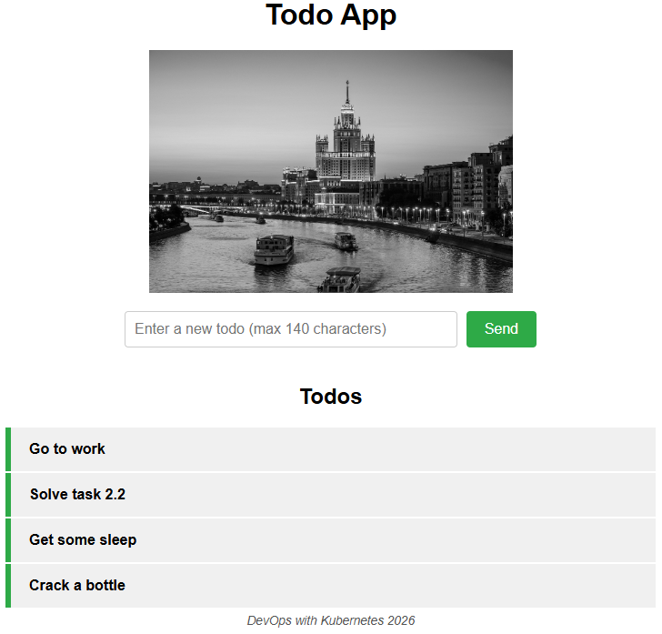
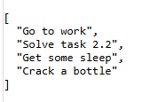
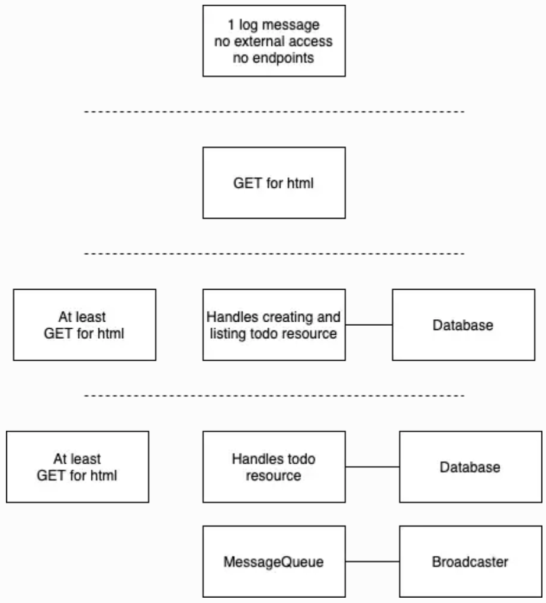

# The project

**Todo-app** is to serve the HTML and JavaScript to the browser. Also, the logic for serving random pictures and caching those remains in that service. Takes care of the todo items.

**Todo-backend** have a GET /todos endpoint for fetching the list of todos and a POST /todos endpoint for creating a new todo. The todos are saved in memory.

## How to start

In `manifests/todo-app-deploy.yaml` you need to set BACKEND_BASE_URL environment variable which point to your base backend URL, for example, http://example.com:1234.

After it's completed, start the rest:

```
kubectl apply -f pv -f manifests
```

## Screenshots

Todo-app (URL: your BACKEND_BASE_URL/)



Todo-backend (URL: your BACKEND_BASE_URL/todos)



## General description of the project

The project is a simple todo application with the familiar features of create, read, update, and delete (CRUD). Todo is a text like "I need to clean the house" that can be in the state of not-done or done.

However, the project app is not just a normal todo app, it has some additional features, many of which shall be added to it as separate microservices. The following picture shows some of the services that were added to the project app along the way.

