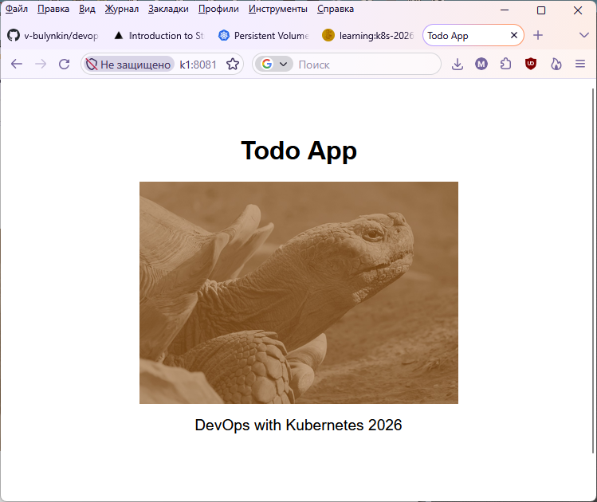

# Todo app

Get a random picture from https://yavuzceliker.github.io/sample-images (Lorem Picsum is unavailable) and display it. The picture stores in cache (persistent volume) and stays the same for 10 minutes regardless of container restarts/crashes. After 10 minutes have passed, a new picture is downloaded.

  
*How does it look like*

## Start in k8s
Firstly, create a PV:
```
kubectl apply -f ../pv
```

Then, start the app:
```
kubectl apply -f ../manifests
```

## External access to the webpage
If you use k3d, you should forward a port to your cluster from Docker, for example, `-p 8081:80@loadbalancer`.  
In this case, the external access will be http://\<your docker server ip or localhost\>:8081  
Ingress path: /  
Service port: 5000  
Pod port: 5000  
